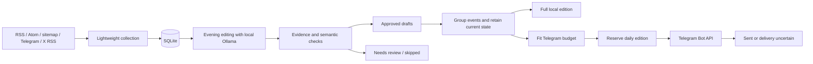

# AI News

[](https://github.com/Lovekach/ai-news/actions/workflows/tests.yml)

Local AI news collector and Russian-language Telegram daily digest. The project gathers public news during the day, prepares checked drafts with a local Ollama model in the evening, and publishes one digest around **21:00 Europe/Moscow**.

It is designed for a personal Windows laptop: collection does not call the LLM, editorial work has a time budget, and the model process owned by this project exits after processing.

## Features

- RSS, Atom and sitemap ingestion with conditional requests, source-specific intervals and failure backoff.
- Public Telegram parsing without a user session; incremental IDs, edited-post invalidation and visible deleted-post handling.
- X account ingestion through public RSS mirrors. Mirrors are unreliable; official feeds can offer alternative coverage.
- SQLite queues, source cursors, drafts and publication receipts.
- Structured local LLM generation, evidence checks, numeric and semantic guards, and a second LLM verification pass. Uncertain claims go to `needs_review`.
- Daily grouping of related events and selection of the latest verified state. A failed merge falls back to an individually approved draft.
- One Telegram message without source URLs, with sentence-aware compaction and qualifying conditions preserved. A longer edition with sources is archived privately.
- Transactional edition reservation and blocked automatic retries after ambiguous delivery.
- Windows Task Scheduler integration with hidden, finite processes.

See [editorial quality checks](docs/EDITORIAL_QUALITY.md) for attribution, date
provenance, publication-time checks and their limitations.

## Architecture



See [ARCHITECTURE.md](ARCHITECTURE.md) for modules, state transitions and failure behavior.

## Example digest

See [the synthetic demonstration](docs/DEMO_DIGEST.md): two related updates become one current story, with separate stories divided by whitespace. All names and events in that example are invented; it is not a real publication or a claim about model performance.

### Stack

Python **3.11+**, standard library (`sqlite3`, `urllib`, `concurrent.futures`, HTML/XML parsers, `unittest`); Windows PowerShell, Task Scheduler and DPAPI; Ollama HTTP API; Telegram Bot API. No third-party Python runtime packages are required.

**Supported runtime: Windows.** File locks use `msvcrt`, tokens use Windows DPAPI, and scheduled execution uses `pythonw.exe`. Linux/macOS support is not implemented.

## Setup

Clone this repository and open PowerShell in its root. Install Python with `python.exe` on PATH, Git, and [Ollama](https://ollama.com/). Then:

```powershell
python -m venv .venv
Copy-Item config.example.json config.json
Copy-Item watchlist.example.json watchlist.json
```

Copy examples only for a **new checkout**; do not overwrite an existing installation's settings.

### Configuration

Edit `config.json`:

- `model`: an installed Ollama model name. The example uses `qwen3.5:9b`; quality and hardware requirements depend on the model.
- `ollama_url`: keep `http://127.0.0.1:11435` for daily mode. This endpoint is reserved for the editor's own finite server.
- `bot_username`: your BotFather username, without `@`.
- `channel_id`: initially `null`; discovery fills it in.
- `auto_publish`: initially `false`; activate after checking a preview.
- `sources`: public HTTPS feeds with explicit allowed hosts. A source may set `poll_seconds`, `freshness_minutes`, `content_from_feed`, `feed_full_content`, `url_contains` or `url_regex`.

The `daily_*` time settings describe the supported schedule. The scheduler and publisher currently implement **21:00 MSK**, rather than arbitrary publication hours or time zones.

In `watchlist.json`, add public Telegram URLs to `telegram` and X URLs to the `x` groups. The group `research_and_comparisons` treats posts as an author's claims rather than company announcements. `official_feed_coverage` maps an X URL to an existing feed's name; it documents alternative coverage and does not create an API connection. Empty lists are valid.

The example sources are public addresses, not credentials. Source access, permitted reuse and availability must be checked for each installation.

### Local model

Install the selected model once using Ollama's normal setup. For the example:

```powershell
ollama pull qwen3.5:9b
.\.venv\Scripts\python.exe -m ainews check-model
```

The application finds `ollama.exe` on PATH and uses installed model files; it does not download models automatically. Daily editing starts a server on **127.0.0.1:11435**, refuses to take over an occupied port, and closes only the process tree it started. It does not control a separate server on default port 11434. `check-model` also uses a finite session.

### Telegram

1. Create a bot with [@BotFather](https://t.me/BotFather).
2. Add it to your channel as an administrator with permission to post.
3. Store the token through the masked local prompt:

```powershell
powershell -NoProfile -File .\scripts\store_token.ps1
```

Do not paste the token into a command, configuration file, GitHub secret or chat. It is encrypted for the current Windows user in `.secrets/bot-token.dpapi`. The application captures the decryptor's output internally; **do not run `read_token.ps1` directly in a terminal**, because it outputs the token for the application.

4. Set `bot_username` in `config.json`. Write a channel message from your own account, then run:

```powershell
.\.venv\Scripts\python.exe -m ainews discover-channel
.\.venv\Scripts\python.exe -m ainews check-channel
```

Discovery and permission checks do not publish messages. If several channels are found, choose the intended ID manually. See [SETUP_TELEGRAM.md](SETUP_TELEGRAM.md).

## Collect, review and preview

```powershell
.\.venv\Scripts\python.exe -m ainews scan-once
.\.venv\Scripts\python.exe -m ainews telegram-scan-once
.\.venv\Scripts\python.exe -m ainews x-scan-once
.\.venv\Scripts\python.exe -m ainews daily-prepare
.\.venv\Scripts\python.exe -m ainews preview-digest
.\.venv\Scripts\python.exe -m ainews review
.\.venv\Scripts\python.exe -m ainews watchlist
```

These commands do not send a new post. `daily-prepare` runs the LLM and updates draft states. Initial official-feed polling establishes a baseline rather than processing its full backlog. Telegram/X initial scans consider recent visible entries. Collection cannot recover posts already missing from sources.

Advertisements, speculation, prerelease builds and stale source articles are filtered. A third-party Telegram repost needs a supported primary-source link for automatic approval. Source URLs remain in SQLite, verification and the private archive. Telegram's public representation removes URL destinations and source blocks while keeping useful hyperlink labels. Domain-shaped product labels remain visible with auto-linking disabled. The Telegram transport checks the final payload again before calling the API.

LLM verification and rule checks reduce errors; they do not independently establish truth or guarantee detection of every factual error. Review questionable drafts before enabling publication.

## Daily publishing

After reviewing a preview and confirming the destination:

```powershell
.\.venv\Scripts\python.exe -m ainews activate
powershell -NoProfile -File .\scripts\install_schedule.ps1 -PythonExecutable "$PWD\.venv\Scripts\python.exe"
```

`activate` checks channel access and enables future publication. The installer creates or updates named AI News tasks after verifying existing tasks belong to this checkout, and saves their previous definitions locally. **Do not install a second checkout over a running installation.**

| Task | Schedule | LLM / publication |
| --- | --- | --- |
| AI News Collector | Every minute; each feed has its own due time/backoff | Neither |
| AI News Telegram | Every 5 minutes | Neither |
| AI News X | Every minute; failure backoff | Neither |
| AI News Editor | 18:00, 20:15, 20:50 MSK | Finite LLM processing; no send |
| AI News Daily Digest | 21:00 MSK | Approved drafts only; one send |

The task remains scheduled at **21:00 MSK**. The publisher accepts **20:56–21:04 MSK** and will not send outside this tolerance. Each edition covers **[yesterday 21:00, today 21:00)** in Moscow, capped at the actual run time for an early invocation. An item published or first discovered at/after the cutoff belongs to a later edition. Publication time and first discovery remain separate: a newly discovered report with an earlier publication time can enter the normal freshness and evidence checks. Fresh, unconsumed backlog is also considered after a missed edition or an interrupted editor run. Used URLs remain excluded by the publication ledger, including uncertain deliveries.

This is eligibility, not automatic approval or an extension of freshness: the existing **24-hour source-age limit**, original-article date checks, evidence requirements and duplicate-event checks still apply. Ready drafts are checked for source age again before publication. Stale reports and opinions do not become new events because they were discovered today. A long laptop outage can therefore leave old news unpublished; the application does not backfill historical editions or send outside the publication window. Grouping retains the newest supported state and prioritizes models, agents, research, open-source and developer tools. The private archive records the UTC coverage interval alongside unchanged publication/discovery dates. Existing calendar-day receipts require no migration or reset.

Telegram targets 3,900 UTF-16 units. When the complete edition cannot fit, lower-priority stories may be omitted from Telegram but remain in `output/daily/YYYY-MM-DD.json`. This private archive contains source identifiers and the exact public text. Bare product identifiers and incomplete sentences are held for review. A JSON string limited by the generation schema can be unfinished even when the JSON itself is valid: only complete preceding sentences may proceed to the existing factual verifier. Empty editions are not posted. **Telegram is the only implemented publication adapter; X is a source, not a publication destination.**

The laptop must be awake and the configured Windows user logged in during evening editing and publication. **AI News intentionally does not wake the laptop:** every installed task explicitly has `WakeToRun=false`, and the application does not change Windows power policy. A sleeping, powered-off or signed-out host cannot guarantee the 21:00 edition. Publication has no late catch-up: waking the laptop later will not trigger a post hours after its window. See [the October 19 incident analysis](docs/publication-sleep-incident.md) for the confirmed sleep failure and evidence limits.

### Failure handling and resources

- A unique `daily:YYYY-MM-DD` ledger entry is reserved transactionally before sending. Overlapping runs cannot reserve it twice.
- A lost Telegram response produces `send_uncertain`; verify delivery manually before recovery. This favors avoiding duplicate posts, not automatic retry or network-level exactly-once delivery.
- Token-read failure before the request leaves drafts available for another attempt within the publication window.
- Started publisher runs log an explicit reason for disabled publication, missing channel configuration, an out-of-window invocation or an existing receipt. If Task Scheduler never starts Python, the application cannot log that missing invocation; use Windows power events and Scheduler history to investigate it.
- Daytime jobs persist data without Ollama. Evening editing has a 25-minute budget; the hidden runner stops the final invocation before publication.
- Windows Job Objects close only the editor's own model process tree, including when its parent exits.
- Logs and SQLite data live under `.state/`; back up the publication ledger privately.

## Tests

```powershell
.\.venv\Scripts\python.exe -m unittest discover -s tests -v
```

Tests use temporary databases, fabricated fixtures and mocked network/publication calls. No production token, running LLM or Telegram channel is required. Cases include Moscow date boundaries, daily reservation/concurrency, uncertain delivery, empty editions, grouping/compaction, source cursors, semantic regressions, resource cleanup and credential redaction. GitHub Actions tests on Windows without production secrets and scans Git history with a checksum-verified Gitleaks binary on a hosted Linux runner.

## Security

- Live settings, DPAPI files, `.state`, databases, logs, archives, caches and models are ignored. Commit only example settings.
- Tokens are loaded through a captured subprocess, not command-line arguments. Diagnostic paths redact known credential formats, authenticated URLs and secret query parameters.
- Feed/article downloads require HTTPS and allowed hosts, including redirects before connection. Configure only trusted public hosts; this is not a sandbox for arbitrary URLs or DNS behavior.
- X mirror dispatchers may redirect to different public HTTPS hosts. Every hop rejects authenticated URLs, local hostnames and non-public IP literals before connection. DNS resolution is not pinned; use only trusted mirror services.
- External text is treated as data in prompts. The model cannot run commands or download code; JSON responses are checked before approval.
- Daily Ollama binds to localhost and has finite lifetime. No public application server is started.
- DPAPI protects secrets at rest for a Windows account, not against malware running as that user.
- CI uses read-only repository permissions, pinned actions and no posting/deployment credentials. Do not run it on the production laptop as a self-hosted runner.

Before public release, scan the **whole Git history**. Rotate committed credentials; ignoring them later is insufficient. See [GITHUB_PUBLICATION_AUDIT.md](GITHUB_PUBLICATION_AUDIT.md) for the publication review.

Report vulnerabilities privately using [SECURITY.md](SECURITY.md). Changes to `main` go through a pull request and the existing Windows Python 3.11 / 3.14 and Gitleaks checks.

## Limits and next steps

This is a personal Windows application, not a hosted service. X mirrors and public Telegram pages can miss posts. Automated evidence checks can miss factual errors, and event grouping is heuristic. Only Telegram publishing is implemented; uncertain delivery requires manual investigation. The laptop must be awake at publication time.

Planned improvements, **not implemented**:

- Expand synthetic editorial fixtures for conflicting reports and changing access conditions.
- Add a local view of source coverage, rejected stories and uncertain deliveries.
- Evaluate more reliable X ingestion options without claiming free mirrors provide complete coverage.

## License

The project code is licensed under [MIT](LICENSE), copyright Lovekach. External news, third-party content and model weights are governed by their own terms; MIT does not grant rights to them.
